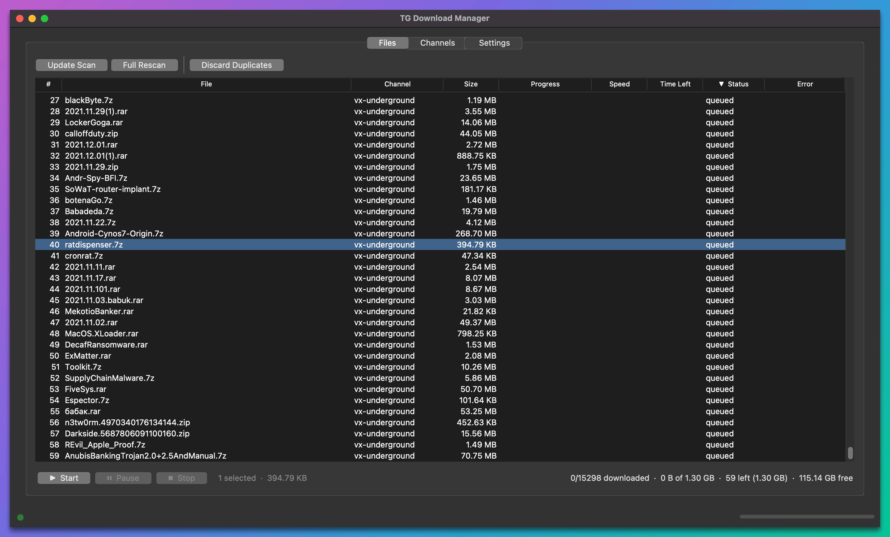
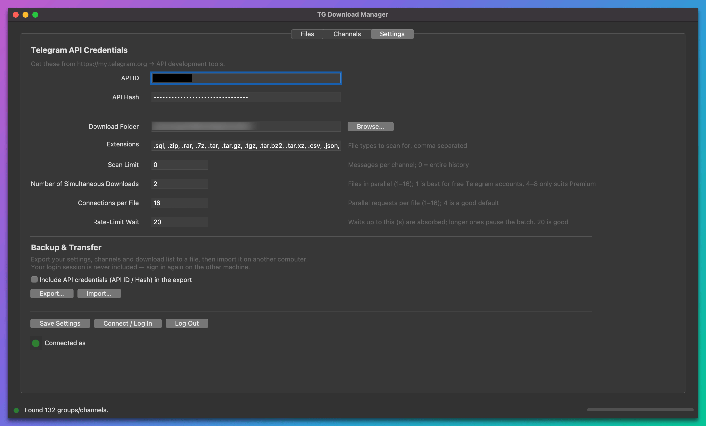
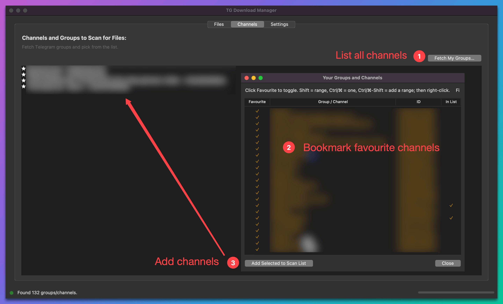
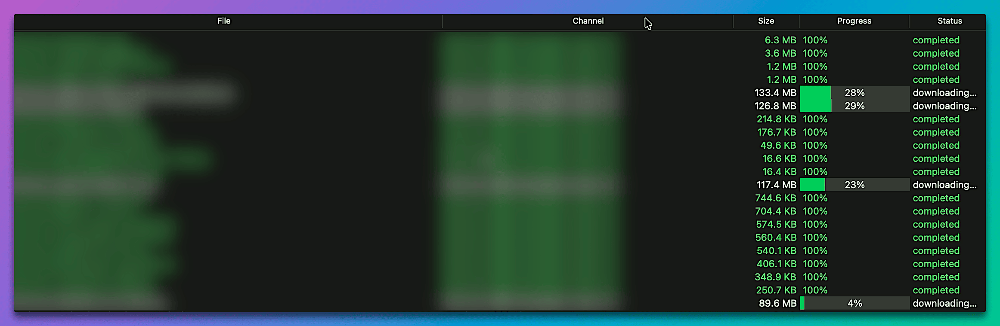

<p align="center">
  
</p>

# TDM — TG Download Manager: A Simple Telegram File Downloader

[](https://github.com/datarip/tg-downloader/actions/workflows/ci.yml)
[](https://github.com/datarip/tg-downloader/releases/latest)
[](LICENSE)



TDM is a **cross-platform Python/Tkinter desktop app** that can download **any file** from
any **public or private channel** you've joined on Telegram. It also ships with its own **headless CLI** for
server installs and cron jobs.

Think of it as **eMule and IDM, but for Telegram**.

More than a file downloader, TDM is aimed at **OSINT enthusiasts and cybersecurity
researchers** who need to collect **evidence** and **extract data** from **private
Telegram channels**: load **every channel you're in**, **bookmark** and **sort** channels, scan their content, and **add files in batches to a download queue**.

Unlike the official Telegram client, which allows only one download at a time, TDM talks to Telegram's **MTProto API** directly.
It can pull **multiple channels in one batch**, keep **several transfers running at once**, and fully **saturate the link** for maximum speed instead of waiting on a single request at a time. **No bot account, no admin rights needed here**: your own
account's access is all it needs.

---

## Install

Prebuilt installers need **no Python, no `uv` and no terminal**. Download the
asset for your OS from the [latest release](https://github.com/datarip/tg-downloader/releases/latest),
then follow the row.

| OS | Asset | Install |
|---|---|---|
| Windows 10/11 (x64) | `TDM-<version>-windows-x64-Setup.exe` | Run the installer. It installs for your user, so there is no admin prompt, then launch **TDM** from the Start Menu. |
| macOS 11+ (Apple Silicon) | `TDM-<version>-macos-arm64.dmg` | Open the DMG, drag **TDM** to **Applications**, then eject the disk image. |
| Linux (x86_64) | `TDM-<version>-linux-x64.AppImage` | `chmod +x TDM-*.AppImage`, then run it. |
| Linux (x86_64, no FUSE) | `TDM-<version>-linux-x64.tar.gz` | `tar -xzf TDM-*.tar.gz`, then run `TDM/TDM`. |

The builds are **unsigned** for now, so each OS warns on first launch. That is
expected, not a sign of a broken download.

**Windows.** SmartScreen shows "Windows protected your PC". Choose **More info**
→ **Run anyway**.

**macOS.** Gatekeeper says the developer cannot be verified. On **macOS 15
(Sequoia) and later** the old right-click → Open shortcut no longer works:
double-click TDM once, dismiss the warning, then open **System Settings →
Privacy & Security** and click **Open Anyway**. On **macOS 14 and older**,
right-click (or Control-click) TDM → **Open** → **Open**. As a scripted
alternative:

```bash
xattr -dr com.apple.quarantine /Applications/TDM.app
```

**Linux.** An AppImage needs `chmod +x` first. Ubuntu 24.04 and later ship
without FUSE 2, so install it (`sudo apt install libfuse2`) or run
`./TDM-*.AppImage --appimage-extract-and-run`. The tarball needs neither.

The installer **downloads nothing** at install time: it unpacks the app it
already contains. The app still needs an internet connection at runtime to
reach Telegram.

### Verify the download

Every release publishes a `SHA256SUMS` file next to the artifacts. Download it
alongside your installer, then hash the file you downloaded and compare it with
the matching line:

```bash
shasum -a 256 TDM-*.dmg        # macOS
sha256sum TDM-*                # Linux
```

```powershell
Get-FileHash .\TDM-<version>-windows-x64-Setup.exe -Algorithm SHA256   # Windows
```

## System requirements

| | |
|---|---|
| Windows | Windows 10 or 11, x64. ARM64 Windows runs the x64 build under emulation. |
| macOS | macOS 11 Big Sur or later, **Apple Silicon only**. There is no Intel build: `cryptg` publishes no x86_64 macOS wheel, so an Intel app would silently fall back to pure-Python AES. Intel Macs run from source. |
| Linux | x86_64, glibc 2.28 or later (Ubuntu 20.04+, Debian 10+, RHEL/Rocky/Alma 8+), X11 or Wayland. |
| Network | Internet access at runtime, to reach Telegram. |
| Disk | Room for the app, plus whatever you download. |

## Where your data lives

Everything is local and in the same folder on every OS:

| Path | Holds |
|---|---|
| `~/.tg_downloader/` | `config.json`, `.env`, `tg_session.session`, `scans.json`, `tg_downloader.log` |

On Windows that folder is `%USERPROFILE%\.tg_downloader`. It is never inside
the app bundle, so upgrading or reinstalling the app leaves your settings, your
scan list and your login session in place. See
[Where your settings live](#where-your-settings-live) for the file-by-file map.

---

## Main Features

- **One list for every channel.** Scan all your groups at once and browse the results
  in a single table, with columns for size, channel, live progress, per-file speed,
  time left, status and error reason.
- **Batch downloads across channels.** **N files in parallel**, **resumable** at any
  point, with pause/stop that takes effect mid-file.
- **Fast single files.** Each file is split into **512 KiB parts** and fetched with
  **several requests in flight** — measured **~6× faster** than one-request-at-a-time.
  See [How the concurrency works](#how-the-concurrency-model-works).
- **Smart resuming.** Partial files are kept on pause, stop, crash or error, and picked
  up from where they were — including **partially downloaded parts**.
- **Handles Telegram's throttling for you.** **Flood waits** and **speed caps** pause the
  whole batch for exactly as long as Telegram asks, then resume automatically.
- **Per-column filters and sorting** (name, channel, size, progress, status), including
  a **status filter** that hides categories you don't care about.
- **Star your channels.** **Favourites** float to the top of the picker, independent of
  the scan list.
- **The list survives restarts.** Files, ticks and discards are **cached**; anything
  already on disk comes back marked as done.
- **Backup & transfer.** Export settings, channels and your download list to one **JSON**
  file — deliberately **without your login session** — and import it on another machine.
- **A real CLI** for **headless** boxes: `tg-download --chat <id> --dry-run`, `--dedupe`,
  cron-friendly.

---

## Limitations

- **Free Telegram accounts are rate-limited.** That still lets you pull **300–500 GB per day**.
- **Premium accounts** ($8/month) can download at **full link speed without that cap**.
- Some channels hide **history** from new members, or enable **"restrict saving
  content"**: those are Telegram channels admin rules and TDM can't circumvent that. See
  [Good to know](#good-to-know).
- It supports file attachments today, but not voice messages, video messages or photo collections. *Might* be considered in the future — see [TO DO](#to-do).

---

## Requirements for running from source

The prebuilt installers bundle all of this. These are the versions the source
tree expects:

| | |
|---|---|
| Python | 3.10+ (`.python-version` pins 3.12) |
| Runtime dependency | `telethon>=1.36`, `cryptg` (native AES — several times faster) |
| Dev dependencies | `pytest`, `pytest-asyncio`, `ruff` |
| GUI toolkit | Tkinter — ships with Python on Windows and the official macOS installer; on Linux you may need `python3-tk` |
| Credentials | `api_id` + `api_hash` from [my.telegram.org](https://my.telegram.org) |

---

## Quick Start

### 1. Install from source

The installers above already bundle Python, Tk and the dependencies. To run the
latest code instead, clone and sync — [uv](https://docs.astral.sh/uv/) installs a
suitable Python for you:

```bash
git clone https://github.com/datarip/tg-downloader.git
cd tg-downloader

uv sync                 # creates .venv and installs everything
uv run tg-downloader    # launch the GUI
```

The CLI is installed alongside: `uv run tg-download --help`. To put the CLI on
your `PATH` without keeping the clone around, run `uv tool install .` from the
checkout and then `tg-download --help`.

<details>
<summary><strong>If you hit <code>ModuleNotFoundError: No module named 'tkinter'</code></strong></summary>

Some Python builds ship without Tk. Easiest first:

```bash
# Option A — let uv install a Python that includes Tk
uv python install 3.12
uv sync

# Option B — Homebrew Python + Tk
brew install python-tk@3.12

# Option C — use your system Python for the GUI only
uv run --python /usr/bin/python3 tg-downloader
```

The CLI (`tg-download`) never imports Tkinter, so it works regardless.
</details>

### 2. How to Get Your Telegram API Credentials

You need an **`api_id`** and **`api_hash`**. They're tied to *your* Telegram account and
are free.

1. Open <https://my.telegram.org> and log in with your phone number. The confirmation
   code arrives **in the Telegram app** (from "Telegram"), not by SMS.
2. Click **API development tools**.
3. Fill in the form — anything sensible works: app title `TDM`, short name `tdm`,
   platform `Other`, and a one-line description. The URL field can stay empty.
4. Submit, then copy the **`api_id`** (a number) and **`api_hash`** (a 32-character
   string).
5. In TDM: **Settings tab → Telegram API Credentials**, paste both, then
   **Save Settings**.



6. Click **Connect / Log In** and enter the login code Telegram sends you. If you have
   two-step verification enabled, you'll be asked for that password too. You only do
   this once — the session is saved.

The connection light next to "Connected as" is **green** when the session is live and
**red** when it isn't. On later launches TDM reconnects by itself without prompting.

> Your `api_hash` is a secret. TDM stores it in a gitignored, `chmod 600` env file — see
> [Where your settings live](#where-your-settings-live).

### 3. How to Add Telegram Channels

Go to the **Channels tab** and click **Fetch My Groups…**. This lists every group and
channel your account can see — typically hundreds — with an ID and an "In List" marker.



1. **Fetch My Groups…** loads your chat list. The red numbers are annotations added for
   this README, not part of the UI: they mark the three steps below.
2. **Favourite** a channel (click the star column) to pin it to the top of the picker —
   handy when you're in 130 groups and only pull from five. Favourites persist across
   runs and are independent of the scan list.
3. Select one or more rows (**Shift** = range, **Ctrl/⌘** = single, **Ctrl/⌘-Shift** =
   add another range) and click **Add Selected to Scan List**. You can also right-click
   for `Favourite` and `Add to scan list`.

**Filter** narrows the fetched list as you type. The Channels tab itself always shows your
current scan list — those channels come from the picker, or from `TG_CHANNELS` in your env
file. If `TG_CHANNELS` is exported in your shell, the scan list is read-only there while
starring still works.

### 4. Scan and Download

Switch to the **Files tab** and run a scan:

- **Full Rescan** — first run, or when you think the cache is stale. Walks each channel's
  whole history (or the last **Scan Limit** messages if you set one) and rebuilds the
  list.
- **Update Scan** — everyday button. Fetches only messages newer than the last scan of
  each channel, so it's fast.

Everything that matches your extension list arrives **ticked**. Untick anything you don't
want (**right-click → Skip**, or select rows and press <kbd>space</kbd>), then press
**▶ Start**. Full or update, the scan list is **cached** — reopening the app shows the
same rows, ticks and discards without re-walking Telegram.

| Action | How |
|---|---|
| Select rows | Click, **Shift**-click for a range, **Ctrl/⌘**-click to scatter, **Ctrl/⌘-Shift** to add another range, <kbd>Ctrl/⌘</kbd>+<kbd>A</kbd> for all |
| Skip / re-add | Highlight → **right-click** → *Skip* / *Add to list*, or <kbd>space</kbd> |
| Remove rows | **right-click** → *Clear from list* |
| Drop reposts | **Discard Duplicates** (same name + size, keeps the first channel's copy) |
| Reorder the queue | **right-click** → *Move to Top / Move to Bottom* |
| Start just these files | **right-click** → *Start* — they jump the whole queue |
| Pause / stop one file | **right-click** → *Pause* / *Stop* (during a run) |
| Reset or delete a row | **right-click** → *Reset* (clears state, deletes the file + `.part`) / *Delete* (with confirmation) |
| Sort | Click a header; click again to reverse (▲/▼) |
| Narrow the list | Right-click a column header for its filter (keywords, size/progress range, status checkboxes) — see [Searching and filtering](#searching-and-filtering) |
| Filter by status | Header menu → **Status** — untick a box to hide that category |
| Recover failed files | **right-click** → *Restore Set-Aside Files* re-ticks every auto-skipped row |
| Reset layout | **right-click a row** → *Reset to Default View* |

### 5. Watch it run

Progress bars fill per file, with per-row **Speed** and **Time Left**, a **batch counter** and an **overall ETA** in
the bottom bar.



**⏸ Pause** and **⏹ Stop** take effect **mid-file**, not only between files. Stopping
**keeps every partial download**; press **▶ Start** later and each one **resumes** where
it left off.

---

## Using the app

### Files tab

Columns: `#` (queue position), **File**, **Channel**, **Size**, **Progress**, **Speed**,
**Time Left**, **Status**, **Error**. Drag headers to reorder, drag edges to resize —
both are remembered. Right-click a row for **Reset to Default View**.

Row statuses:

| Status | Meaning |
|---|---|
| `completed` | On disk. |
| `on disk` | A file with the same name and size already exists in the folder, so it was skipped instead of overwritten. |
| `downloading…` | In flight. |
| `queued` | Ticked and waiting its turn, including a file that's mid-retry. |
| `incomplete` | A partial `.part` exists; **Start** resumes it. |
| `moved` | Finished once, but the file is no longer in the download folder. Re-tick to fetch again. |
| `paused` | Parked on a rate limit, or paused by you. |
| `skipped` | Not ticked, so it won't be downloaded. |
| `error: <cause>` | Failed; `.part` kept. The **Error** column says why. |

Failures are **retried automatically** with a growing backoff, and the **cause** is
surfaced (`timeout`, `no connection`, `not found`, `rate limited`, `speed capped`,
`no storage`). A genuinely broken file is **set aside** — unticked, moved to the bottom,
reason kept — so it doesn't burn the queue. **Network outages** and a **missing download
folder** stop the batch safely instead of failing thousands of files in a row.

### Searching and filtering

Filters live on the column headers. **Left-click** a header to sort; **right-click** it to
open that column's filter panel. Everything applies **live** as you type or tick — there's
no Apply button — and a column with an active filter shows a **green funnel** in its
header. Click outside or press <kbd>Esc</kbd> to close a panel.

| Column | Filter | How it works |
|---|---|---|
| **File** | Contains / Does not contain | Case-insensitive substring match on the filename. Keywords are **pills**: type a word, press <kbd>Enter</kbd> to add it; click ✕ (or press <kbd>Backspace</kbd> in the empty box) to remove one. |
| **Channel** | Contains / Does not contain | Same as File, matched against the channel title. |
| **Size** | Min / Max (MB) | Inclusive whole-megabyte bounds. Either side can be left blank. |
| **Progress** | Min / Max (%) | 0–100. A completed file counts as **100**, one that never started as **0**, so `Min 100` shows finished work and `Max 99` shows what's left. |
| **Status** | Checkboxes | Which lifecycle categories to show: downloading, queued, incomplete, paused, stopped, completed, moved, skipped. |
| **#**, **Speed**, **Time Left**, **Error** | — | No filter. `#`, Speed and Time Left still sort (`#` by queue position); Error doesn't. |

How the pieces combine:

- Text keywords are **OR**'d inside a column: pills `invoice` and `report` match a file
  containing *either* one. Switching to **Does not contain** turns the same list into a
  blacklist — any listed word hides the row (`_tmp`, `draft`, a language you don't need).
- Columns **AND** together: a row has to pass the name filter, the size range and the status
  filter to stay visible.
- The **Status filter is negative**: everything is visible until you untick a category, and
  all eight start ticked. Unticking *Completed* is the usual "what's left" view; unticking
  *Skipped* removes the greyed-out rows.
- It can't drift from the column: both the Status column and the Status filter derive the
  category the same way, so a throttled-but-ticked file appears under **Paused**, and an
  unticked file appears under **Skipped**, whatever raw status it carries.
- Numbers are **whole units** (no decimals) and typed values that don't parse yet constrain
  nothing.

**Clear** inside a panel resets only that column. Once anything is filtered, the list's
right-click menu gains **Clear All Filters**. Filters persist across launches — they're
stored in `config.json`, so the view you rely on is there next time.

### Channels tab

Add, remove, and favourite groups. The status bar confirms how many groups were found
and added. Removing a channel from the scan list does **not** un-favourite it.

### Settings tab

`api_id` / `api_hash`, download folder, extensions, scan limit, the two concurrency
knobs, rate-limit threshold, and **Backup & Transfer** (export/import, with an optional
"include API credentials" checkbox — the login session is never exported).

**Rate-Limit Wait** (seconds, default 20) is the cutoff: waits shorter than this are
absorbed **silently per request**; longer ones pause the **whole batch**, show
`rate limited` or `speed capped`, and **resume automatically**. It applies **live**, even
mid-download.

---

## Configuration

### Where your settings live

100% local: your settings and credentials stay on your machine, always. You probably won't need to touch these files since the GUI writes them.

Here is the map:

| Path | Holds |
|---|---|
| `~/.tg_downloader/.env` (or `./.env`) | `TG_API_ID`, `TG_API_HASH`, `TG_CHANNELS` — **gitignored, `chmod 600`** |
| `~/.tg_downloader/config.json` | download folder, extensions, scan limit, concurrency, favourites, filters, column layout — no secrets |
| `~/.tg_downloader/tg_session.session` | **your live Telegram login.** Never commit, copy or share it |
| `~/.tg_downloader/scans.json` | the scanned file list, ticks and discards |
| `~/.tg_downloader/tg_downloader.log` | rotating run log: errors, causes, waits, filenames |

Saving **never copies secrets** into `config.json`; an old install's `api_hash` is
**migrated out** of it on the first save. **Shell variables outrank the file**, and those
fields show as **read-only** rather than accepting an edit that could never take effect.

### Setting it up without the GUI

```bash
cp .env.example .env && chmod 600 .env
```

```ini
TG_API_ID=1234567
TG_API_HASH=0123456789abcdef0123456789abcdef

# comma-separated: numeric id, @username, or id=Title. A JSON list also works.
TG_CHANNELS=-1001234567890=Research Dumps, @somegroup

# optional — these otherwise live in config.json
TG_DOWNLOAD_DIR=~/Downloads/TG
TG_EXTENSIONS=.zip, .tar.gz, .csv, .json
TG_SCAN_LIMIT=0
```

A GUI save edits the file in place: your comments and unrelated variables survive.

Settings resolve **first match wins** (**environment** → **env file** → **config.json** →
**defaults**):

| # | Source |
|---|---|
| 1 | the process environment (`TG_SCAN_LIMIT=100 uv run tg-download`) |
| 2 | an env file — `./.env`, else `~/.tg_downloader/.env`; override with `--env-file` or `$TG_ENV_FILE` |
| 3 | `~/.tg_downloader/config.json` |
| 4 | built-in defaults |

### Moving to another machine

**Settings → Backup & Transfer → Export…** writes one JSON bundle with your portable
settings, channels and download list (ticks and set-aside markers included). Import it on
the new machine and everything merges: local ticks and discards win, channels already
there are kept. Your download folder is intentionally not exported (an absolute path from
one machine rarely exists on another), and the login session never travels — sign in
fresh.

---

## CLI

The CLI has no Tkinter dependency and no GUI state to fight with. It reads the same
config and env file.

```bash
# list your groups/channels with ids
uv run tg-download --list-chats

# see what would happen, without downloading
uv run tg-download --chat -1001234567890 --dry-run

# download everything matching your extensions
uv run tg-download --chat -1001234567890

# data files only, recent history, custom output folder, 8 requests in flight
uv run tg-download --chat @somegroup --ext .csv,.json,.jsonl --limit 500 \
    --out ~/data --connections 8

# scan several channels but skip files reposted between them
uv run tg-download --chat @channel_a --chat @channel_b --dedupe

# use the channel list from .env (TG_CHANNELS) or the GUI
uv run tg-download

# export / import a portable bundle
uv run tg-download --export tdm-backup.json
uv run tg-download --import tdm-backup.json
```

| Flag | Meaning |
|---|---|
| `--chat` | Chat @username, id or link. Repeatable. Defaults to your saved channels. |
| `--ext` | Comma-separated extensions. Defaults to your config. |
| `--out` | Download directory. |
| `--limit` | Max messages to scan per chat. Default: entire history. |
| `--connections` | Requests in flight per file (1–16). Default from config (4). |
| `--dedupe` | Skip reposts — same name and size already seen this run. |
| `--dry-run` | List what would be downloaded, then exit. |
| `--list-chats` | Print your groups/channels with ids, then exit. |
| `--env-file` | Env file with credentials/channels. Default `./.env`, else `~/.tg_downloader/.env`. |
| `--export FILE` / `--import FILE` | Write / read a portable bundle. |
| `--include-secrets` | With `--export`, include the API id/hash. |

The CLI waits out **rate limits** and **dropped connections** indefinitely rather than
giving up on a file, and keeps `.part` files so a re-run **resumes**. It aborts a run if
the output folder disappears instead of failing every remaining file.

---

## Supported File Types for Downloading

Only files whose name ends with an **allowed extension** — and that decision is made
**while scanning**, not at download time. A message that doesn't match never becomes a row:
it isn't hidden later, it was never in the list. That's what keeps walking a
200,000-message channel cheap and the file list usable.

Defaults:

```
archives:  .zip .rar .7z .tar .tar.gz .tgz .tar.bz2 .tar.xz
data:      .csv .json .jsonl .txt
```

Matching rules:

- **Case-insensitive** — `REPORT.CSV` matches `.csv`.
- **End-of-name, longest first** — matched against the end of the lowercased filename rather
  than by splitting on the last dot, so `.tar.gz` counts as one extension and wins over a
  bare `.gz`.
- **Comma or space separated**, with the **leading dot optional**, and everything
  lowercased: `zip, .CSV  json` → `.zip .csv .json`.
- **No filename, no match.** Photos, videos and voice notes have no filename in Telegram's
  data model, so there's nothing to test. Files without a dot (a bare `README`) don't match
  either, since every entry is an extension.

Change the list in **Settings → Extensions** (`File types to scan for, comma separated`), in
your env file as `TG_EXTENSIONS`, or per run with `--ext`. It takes effect on the **next
scan**; rows already in the list keep their state.

This allow-list is **not** the same as the Files-tab column filters: the allow-list decides
what gets scanned and downloaded at all, while the [column filters](#searching-and-filtering)
only hide rows that are already in the list. An extension left out of the allow-list can't
be brought back by any filter.

### Layout on disk

```
~/Downloads/TG/
├── Some Group/
│   ├── archives/
│   │   └── 8231_dataset.tar.gz
│   └── data/
│       └── 8244_export.csv
└── Another Group/
    └── data/
        └── 155_notes.txt
```

The subfolder follows the **matched extension**: archive types (`.zip`, `.rar`, `.7z`,
`.tar`, `.tar.gz`, `.tgz`, `.tar.bz2`, `.tar.xz`) go to `archives/`, every other allowed
type to `data/`.

The `<msg_id>_` prefix keeps identically named files apart and makes re-runs
**idempotent**: if the path exists, it's already downloaded. Downloads go to a `.part` file
and are renamed only on success, so an interrupted run never leaves a truncated archive
looking complete.

---

## Good to know

**Hidden history.** Supergroups can set "Chat history for new members: Visible / Hidden".
If it's Hidden and you joined recently, you only see messages from your join point
onward — same as scrolling up in the app. The scan can't get what your account can't see.

**Content protection.** If admins enable "restrict saving content", Telegram blocks
downloads server-side and TDM warns you up front (`noforwards`) instead of failing 900
messages in.

**Deleted messages.** A file deleted since your last scan errors with "message no longer
available"; the rest of the queue continues.

**The session file is a live login.** `tg_session.session` grants full access to your
account — don't sync, copy or back it up anywhere you don't trust.

---

## Why TDM Uses MTProto Instead of the Bot API

Telegram's **Bot API** can't read a channel's **message history** — a bot only sees
messages sent after it joins, and only if privacy mode is off. To pull files that were
shared before today you have to authenticate as **yourself**, which is what **MTProto**
(and [Telethon](https://docs.telethon.dev)) does.

Practical consequence: **you don't need to be an admin.** If you can see and scroll a
file in the Telegram app, this tool can download it.

---

## How the Concurrency Model Works

There are two independent knobs, and they multiply:

| Setting | Meaning | Range | Default |
|---|---|---|---|
| **Number of Simultaneous Downloads** | Files downloaded at the same time | 1–16 | 1 |
| **Connections per File** | Requests in flight *inside* one file | 1–16 | 4 |

### Why Is a Single Telegram Download Slow on Its Own?

MTProto downloads a file with repeated `upload.getFile(offset, limit)` calls, and
Telethon's maximum request size is **512 KiB**. Over a single connection that's a strict
**ping-pong**:

```
ask [0 .. 512K)    →  ──── round-trip ────  →  receive 512K
ask [512K .. 1M)   →  ──── round-trip ────  →  receive 512K
ask [1M .. 1.5M)   →  ──── round-trip ────  →  receive 512K
```

The next request can't leave until the previous reply lands, so throughput is capped by
**latency**, not by your bandwidth:

```
throughput ≈ 512 KiB / round-trip time
           ≈ 4 MB/s at a 120 ms round-trip — on any link, 50 Mbps or 1 Gbps
```

The connection sits idle for most of every round-trip. That idle time is the whole gap
between a one-connection client and the Telegram desktop app.

### The Solution: Keep Several Requests in Flight

TDM splits the file into 512 KiB chunks and keeps **N `GetFileRequest`s outstanding at
once**, each for a different part, writing each completed part straight into the
preallocated `.part` file. The round-trips overlap instead of running end to end:

```
req 0:  ├─ ask ─┤········ RTT ········├─ recv ─┤
req 1:     ├─ ask ─┤········ RTT ········├─ recv ─┤
req 2:        ├─ ask ─┤········ RTT ········├─ recv ─┤
req 3:           ├─ ask ─┤········ RTT ········├─ recv ─┤
```

Same call, same 512 KiB chunks, N of them in flight — classic **request pipelining**. That's
where the **~6× single-file speedup** comes from, and what `Connections per File` controls.

Details worth knowing:

- The requests share **one connection to the media data center** (Telethon hands out a
  single ref-counted sender per DC), so `Connections per File` really means *requests in
  flight*, not extra sockets. Pipelining is the point.
- A completed part is recorded in a `.part.idx` sidecar, so a resumed run only fetches
  the parts that are still missing.
- A short flood wait is absorbed by that one worker silently; only a long throttle
  reaches the batch coordinator that pauses everything and shows the reason.
- `Connections per File = 1` falls back to the plain append-only path — still fully
  resumable, just latency-bound.

### What to set

Both knobs compete for the same budget, because Telegram's download cap on free accounts
is **account-wide**, not per file:

- **Free account:** keep `Number of Simultaneous Downloads` at **1–2** and push
  `Connections per File` to **8–16**. Parallel files buy you little against an
  account-wide cap; pipelining one file is what removes the latency ceiling.
- **Premium account:** raise the file count to **4–8** as well — there's headroom for
  both.

Pushing both to 16 doesn't make it 256× faster; once the account cap is reached the extra
requests just queue behind it.

---

## TO DO

Planned, not implemented yet:

- [ ] **Multi-account support** — keep several Telegram accounts signed in, and pick which
  one a scan or a download runs as (or run them side by side for separate quotas).
- [ ] **Proxy support** — SOCKS5 / HTTP / MTProxy, for networks where Telegram is blocked
  or where traffic has to leave through a specific exit.
- [ ] **Channel conversation feed** — one `feed.csv` per channel capturing every message in
  chronological order (text, sender, date, media reference), written during the scan so it
  costs no extra requests.
- [ ] **Voice, video and photo collection** — nameless media saved as `<msg_id>.<ext>` in
  `voice/`, `video/` and `photos/` subfolders, behind per-kind settings toggles.
- [ ] **Media rollups in the Files tab** — one row per channel × media kind with aggregated
  progress and drill-down, so a channel with thousands of voice notes doesn't flood the
  list.
- [ ] **Historical download order** — an optional oldest-first queue instead of today's
  newest-first scan order.

Each of these has a local design note covering layout, edge cases and phasing; the notes
stay out of the repository until the work ships, then the user-facing part will land in this
README.

---

## Uninstall

The app and your data are separate. Uninstalling removes the app and leaves
`~/.tg_downloader/` untouched.

| OS | Remove the app |
|---|---|
| Windows | **Settings → Apps → TDM → Uninstall**. This is `unins000.exe` in the install folder; it removes the program and its shortcuts. |
| macOS | Drag **TDM** from **Applications** to the Trash, then empty it. |
| Linux | Delete the AppImage file, or the folder you extracted the tarball into. |

To remove your data as well:

```bash
rm -rf ~/.tg_downloader                                       # macOS and Linux
```

```powershell
Remove-Item -Recurse -Force "$env:USERPROFILE\.tg_downloader"  # Windows
```

**This logs you out** (the session is in that folder), forgets your settings and
drops the cached file list. Files you already downloaded are not touched.

## Privacy

- **No telemetry, no analytics, no crash reporting.** Nothing about your usage
  leaves the machine.
- TDM talks to **Telegram's servers** with your own account, over the MTProto
  API. That traffic is the point of the app.
- To tell "the internet is down" from "Telegram is unreachable", it opens a
  **bare TCP connection** to Cloudflare's (`1.1.1.1:443`) or Google's
  (`8.8.8.8:53`) public DNS address, and to the Telegram data centre your
  session uses. No payload, no identifier and nothing about your files is sent.
- Your settings, session, scan cache and log stay in `~/.tg_downloader/`. The log
  records filenames, chat titles and error text, and never your `api_hash` or
  your login code.
- A backup bundle never contains the login session. `api_id` and `api_hash` are
  included only if you tick **include API credentials**.

---

## Development

```bash
uv sync                  # install deps including the dev group
uv run pytest            # unit tests + doctests in src/
uv run pytest -v         # verbose
uv run ruff check .      # lint
uv run ruff format .     # format
```

Layout:

```
src/tg_downloader/
├── filters.py     extension matching, name sanitising, subfolders  (no telethon)
├── config.py      load/save config + env-file credential layer     (no telethon)
├── models.py      FileItem, target paths, dedupe                   (no telethon)
├── store.py       scan cache + merge rules                         (no telethon)
├── filtering.py   Files-tab filter predicates                      (no telethon)
├── worker.py      background asyncio thread + download pool        (no telethon)
├── errors.py      error classification, rate limits, logging       (no telethon)
├── portable.py    export/import bundles                            (no telethon)
├── telegram.py    thin Telethon layer: client, scan, download
├── app.py         Tkinter GUI
└── cli.py         headless CLI
```

The "no telethon" modules are deliberate: all the logic worth testing lives there, so
`pytest` runs with no network, no session, and no mocking.

Further reading in [`docs/`](docs/):

- [`telethon-archived-and-alternatives.md`](docs/telethon-archived-and-alternatives.md) —
  upstream status and alternatives.

### Test status

Covered: extension matching, config round-trip and permissions, the env credential layer,
path construction (including hostile chat titles and traversal attempts), de-duplication,
scan-cache merge rules, resumable downloads (single-stream and pipelined, via a fake
client — no network), error classification, and the pause/resume/stop state machine
including stop-while-paused.

Not covered: the Tkinter widget layer and live Telegram calls — those need a display and
a real session.

---

## Credits

TDM is built on [**Telethon**](https://github.com/LonamiWebs/Telethon), the MIT-licensed
MTProto client by LonamiWebs. Almost all of the Telegram-facing work is Telethon's:
phone/code/2FA login, session persistence, entity resolution, message iteration, media
location, and the raw `upload.getFile` calls. TDM never speaks MTProto itself — it drives
Telethon's client and builds the application around it. Downloads also rely on
[**cryptg**](https://github.com/Lonami/cryptg) for native AES decryption, which is what
keeps them from becoming CPU-bound.

**What TDM adds on top:**

- the **scan and cache layer** — extension matching, watermark-based update scans, the
  persistent file list with ticks/discards, de-duplication and portable backups;
- the **batch download engine** — parallel files, queue lanes, resume, retries, error
  classification and the batch-wide rate-limit coordinator;
- the **pipelined single-file downloader** — 512 KiB parts with several `GetFileRequest`s
  in flight and a `.part.idx` bitmap. Telethon's own `iter_download` /
  `download_media` stream one chunk at a time, append-only, which is latency-bound and
  has no resume; this is the same overlapping-requests approach the Telegram desktop app
  uses;
- the **Tkinter GUI** and the **CLI**.

Upstream Telethon was archived in February 2026 — v1.44 still works, and
[this note](docs/telethon-archived-and-alternatives.md) covers the alternatives if that
ever changes.

---

## License

MIT.
